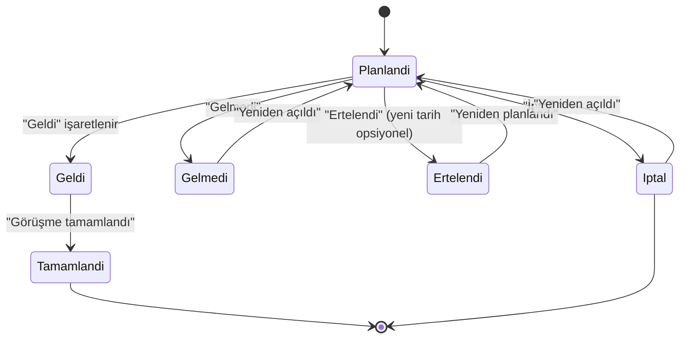
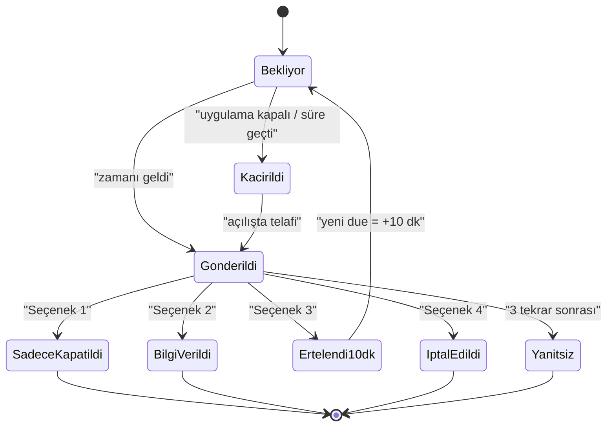

# 02 — Yazılım Gereksinimleri

**Sürüm:** 0.1 · **Tarih:** 06.11.2026 · **Durum:** Onay bekliyor
**İlgili:** [Analiz](01_Analiz_ve_Eksikler.md) · [Mimari](03_Mimari_ve_Veri_Modeli.md)

Bu doküman; iş gereksinimlerini, işlevsel/fonksiyonel olmayan gereksinimleri, iş
kurallarını, durum makinelerini ve kabul kriterlerini tek yerde toplar. Her gereksinim
benzersiz bir kimlik taşır ve test/sprint ile izlenebilir.

---

## 1. Aktörler ve yetki matrisi

| Aktör | Tanım |
|-------|-------|
| **Yönetici (Admin)** | Tüm ayarlar, kullanıcılar, kategoriler, yedek/geri yükleme, silme |
| **Sekreter** | Görüşme ekle/düzenle, liste, paylaşım, sonuç, yedek al |
| **Görüşmeci (Host)** | Kendi görüşmelerini görür, sonuç girer; randevu oluşturamaz |
| **Sistem** | Zamanlayıcı, hatırlatıcı, yedekleme, push gönderimi |

| Yetki | Yönetici | Sekreter | Görüşmeci |
|-------|:--------:|:--------:|:---------:|
| Görüşme görüntüleme | Tümü | Tümü | Yalnızca kendisi |
| Görüşme ekleme | ✓ | ✓ | — |
| Görüşme düzenleme | ✓ | ✓ | Yalnızca sonuç alanları |
| Görüşme silme / geri alma | ✓ | — | — |
| Sonuç girme | ✓ | ✓ | Kendi görüşmesi |
| Kategori yönetimi | ✓ | — | — |
| Kullanıcı yönetimi | ✓ | — | — |
| Ayarlar | ✓ | Kısmi (tema, bildirim) | Kısmi (tema) |
| Yedek alma | ✓ | ✓ | — |
| Geri yükleme | ✓ | — | — |
| WhatsApp paylaşımı | ✓ | ✓ | Kendi detayı |
| Denetim kaydı | ✓ | — | — |
| Alıcı rehberi | ✓ | ✓ | — |

> Not: Tek bilgisayar/tek oturum modelinde roller **yerel hesaplarla** uygulanır.
> Yetki kontrolü yalnızca arayüzde değil, uygulama servis katmanında da yapılır.

---

## 2. Fonksiyonel gereksinimler

### 2.1 Kimlik ve erişim (AUTH)

| ID | Gereksinim | Öncelik |
|----|------------|---------|
| FR-AUTH-01 | Kullanıcı, kullanıcı adı ve şifre ile giriş yapar. | P0 |
| FR-AUTH-02 | İlk kurulumda bir yönetici hesabı oluşturulur; varsayılan şifre yoktur. | P0 |
| FR-AUTH-03 | Şifre en az 8 karakter, en az bir harf ve bir rakam içerir; PBKDF2-SHA256 (≥210.000 iterasyon) ile saklanır. | P0 |
| FR-AUTH-04 | 5 hatalı denemede hesap 15 dakika kilitlenir; kalan süre gösterilir. | P1 |
| FR-AUTH-05 | Oturum, açık çıkış yapılana kadar açık kalır (süre sınırı yok). Kullanıcı isterse elle kilitler; kilit şifreyle açılır ve yeniden başlatmada korunur. | P1 |
| FR-AUTH-06 | Kullanıcı kendi şifresini değiştirebilir; yönetici şifre sıfırlayabilir. | P1 |
| FR-AUTH-07 | Rol ataması yalnızca yönetici tarafından yapılır. | P1 |
| FR-AUTH-08 | Başarılı/başarısız giriş denemeleri denetim kaydına yazılır (şifre asla loglanmaz). | P1 |
| FR-AUTH-09 | "Beni hatırla" yalnızca çıkış sonrası giriş formunun ön doldurulmasını yönetir; oturum süresizdir ve şifre değişiminde kayıtlı kimlik güncellenir. | P1 |

### 2.2 Görüşme yönetimi (APPT)

| ID | Gereksinim | Öncelik |
|----|------------|---------|
| FR-APPT-01 | Yeni görüşme; ad, soyad, telefon, tarih, saat, görüşülecek kişi (host), kategori, açıklama, yöntem, hatırlatıcılar ve opsiyonel öğrenci ad-soyadı ile oluşturulur. | P0 |
| FR-APPT-02 | Zorunlu alanlar: ad, soyad, telefon, tarih, saat, host, kategori, yöntem. Açıklama ve öğrenci alanı opsiyoneldir. | P0 |
| FR-APPT-03 | Telefon E.164 biçimine normalize edilir (`+905321234567`); geçersiz numara kaydedilmez. | P1 |
| FR-APPT-04 | Görüşme yöntemi tek seçimdir: Telefon, Yüz yüze, WhatsApp mesajı, İnternet. Varsayılan: Yüz yüze. | P0 |
| FR-APPT-05 | Süre varsayılan 30 dk'dır; 5-240 dk arasında düzenlenebilir. | P1 |
| FR-APPT-06 | Hatırlatıcılar çoklu seçilir: 1 gün (1440 dk), 1 saat (60 dk), 30 dk. Varsayılan yalnızca 30 dk. Seçim boş bırakılabilir (uyarı gösterilir). | P0 |
| FR-APPT-07 | Aynı kişi + aynı host + çakışan saat için uyarı gösterilir; kullanıcı bilinçli olarak devam edebilir. | P1 |
| FR-APPT-08 | Kayıt sonrası seçilen her hatırlatıcı için kalıcı zamanlama üretilir. | P0 |
| FR-APPT-09 | Görüşme durumu: Planlandı, Geldi, Gelmedi, Ertelendi, İptal, Tamamlandı. | P0 |
| FR-APPT-10 | Görüşme düzenlendiğinde tarih/saat/hatırlatıcı değişirse bekleyen hatırlatıcılar yeniden hesaplanır; gönderilmiş olanlar tekrar gönderilmez. | P0 |
| FR-APPT-11 | Görüşme silme yumuşaktır (soft delete); 30 gün içinde geri alınabilir. Kalıcı silme yalnızca yöneticide. | P1 |
| FR-APPT-12 | Görüşme, kişi adı/soyadı, telefon, kategori, host ve duruma göre aranır/filtrelenir. | P0 |
| FR-APPT-13 | Randevu saati geçmiş ve durum hâlâ "Planlandı" ise listede "gecikmiş" olarak vurgulanır. | P1 |
| FR-APPT-14 | Aynı kişi için yeni görüşme oluşturulurken ad/telefon otomatik tamamlanır. | P1 |
| FR-APPT-15 | Görüşme kopyalanabilir ("Yeni görüşme olarak kopyala"), tarih/saat boş bırakılır. | P2 |

### 2.3 Günlük görüşme listesi (LIST)

| ID | Gereksinim | Öncelik |
|----|------------|---------|
| FR-LIST-01 | Ana ekran, seçili günün görüşmelerini liste hâlinde gösterir. | P0 |
| FR-LIST-02 | Başlıkta tarih `gg/AA/yyyy` biçiminde görünür (örn. `06/11/2026`). | P0 |
| FR-LIST-03 | Tarihin solunda "önceki gün", sağında "sonraki gün" butonu bulunur. | P0 |
| FR-LIST-04 | Tarihe tıklanınca takvimden gün seçilebilir; "Bugün" butonu vardır. | P1 |
| FR-LIST-05 | Liste randevu saatine göre artan sırada; aynı saatte olanlar oluşturma sırasına göre listelenir. | P0 |
| FR-LIST-06 | Her satırda ad soyad, saat, host, kategori ve durum rozeti görünür. | P0 |
| FR-LIST-07 | Satıra tıklanınca Görüşme Detayları ekranı açılır. | P0 |
| FR-LIST-08 | Sağ altta, liste üzerinde yüzen "artı" butonu yeni görüşme ekranını açar. | P0 |
| FR-LIST-09 | Artı butonunun altında, aynı biçimde yüzen "gönder" butonu günlük listeyi WhatsApp'ta paylaşma akışını başlatır. | P0 |
| FR-LIST-10 | Liste boşsa "Bu tarihte görüşme yok" mesajı ve "Görüşme ekle" butonu görünür. | P1 |
| FR-LIST-11 | Liste üstünde gün özeti gösterilir: toplam, tamamlanan, gelmeyen. | P2 |
| FR-LIST-12 | Liste, 1000 kayıtta dahi akıcı kaydırma için sanallaştırılır. | P1 |
| FR-LIST-13 | Yaklaşan/sırası gelen görüşme için üstte "Sıradaki: 14:30 — Ahmet Yılmaz — Ara" şeridi görünür. | P1 |

### 2.4 Görüşme detayları (DET)

| ID | Gereksinim | Öncelik |
|----|------------|---------|
| FR-DET-01 | Ekleme ekranındaki tüm alanlar okunaklı bölümler hâlinde gösterilir. | P0 |
| FR-DET-02 | "Görüşmeyi düzenle" yüzen butonu düzenleme ekranını açar. | P0 |
| FR-DET-03 | "WhatsApp'tan gönder" yüzen butonu görüşme detay metnini paylaşım akışına verir. | P0 |
| FR-DET-04 | "Ara" butonu telefon uygulamasını `tel:` bağlantısıyla açar (opsiyonel). | P2 |
| FR-DET-05 | Görüşme sonucu bölümü; katılım, görüşmenin değerlendirmesi, tekrar edilip edilmeyeceği, görüşme sonrası açıklama ve kapanış bilgisini içerir. | P0 |
| FR-DET-06 | Sonuç yoksa "Henüz sonuç girilmedi" ve "Sonuç gir" butonu gösterilir. | P1 |
| FR-DET-07 | Kapanmış görüşmede kapanış tarihi/saati ve kapatan kullanıcı görünür. | P1 |
| FR-DET-08 | Değişiklik geçmişi (kim, ne zaman, hangi alan) görüntülenebilir. | P2 |
| FR-DET-09 | Detay ekranından "Tekrar randevu oluştur" ile yeni görüşme taslağı açılır. | P1 |

### 2.5 Görüşme düzenleme (EDIT)

| ID | Gereksinim | Öncelik |
|----|------------|---------|
| FR-EDIT-01 | Detaydaki tüm alanlar dolu ve düzenlenebilir gelir. | P0 |
| FR-EDIT-02 | Görüşme sonucu bölümü düzenleme ekranında da bulunur. | P0 |
| FR-EDIT-03 | Kişi, tarih/saat, host, kategori, açıklama, yöntem ve hatırlatıcılar değiştirilebilir. | P0 |
| FR-EDIT-04 | Kaydetmeden çıkışta "Kaydedilmemiş değişiklikler var" onayı gösterilir. | P1 |
| FR-EDIT-05 | Eşzamanlı değişiklik koruması: kayıt sürümü (rowversion) çakışmayı bildirir. | P2 |
| FR-EDIT-06 | Kapanmış görüşme düzenlenirse uyarı gösterilir ve denetim kaydına yazılır. | P1 |

### 2.6 Kategoriler (CAT)

| ID | Gereksinim | Öncelik |
|----|------------|---------|
| FR-CAT-01 | Kategori ekleme: ad (benzersiz), renk, sıra, aktiflik. | P0 |
| FR-CAT-02 | Kategori düzenleme ve sıralama (yukarı/aşağı veya sürükle-bırak). | P1 |
| FR-CAT-03 | Kullanımda olan kategori silinemez; pasifleştirilebilir. | P0 |
| FR-CAT-04 | Pasif kategori yeni kayıtta seçilemez; eski kayıtlarda görünür. | P1 |
| FR-CAT-05 | İlk kurulumda eğitim kurumu örnek kategorileri: Veli Görüşmesi, Öğrenci Görüşmesi, Rehberlik/Danışmanlık, Bilgi Talebi, Şikâyet, Disiplin/İnceleme, Diğer. | P1 |
| FR-CAT-06 | Ad 2-50 karakter; aynı ad (büyük/küçük harf duyarsız) tekrar edemez. | P1 |

### 2.7 Hatırlatıcı ve bildirim (REM)

| ID | Gereksinim | Öncelik |
|----|------------|---------|
| FR-REM-01 | Randevu kaydedildiğinde/düzenlendiğinde hatırlatıcılar kalıcı olarak planlanır. | P0 |
| FR-REM-02 | Desteklenen aralıklar: 1440, 60, 30 dakika; aynı randevuda birden fazla seçilebilir. | P0 |
| FR-REM-03 | Zamanı gelen hatırlatıcı için Windows toast ve uygulama içi aksiyon penceresi gösterilir. | P0 |
| FR-REM-04 | Aksiyon penceresinde görüşme özeti (ad, saat, host, kategori, telefon) ve 4 kapatma seçeneği bulunur. | P0 |
| FR-REM-05 | Seçenek 1 — "Bildirimi kapat": yalnızca bildirim kapanır; "bilgi verilmedi" olarak loglanır. | P0 |
| FR-REM-06 | Seçenek 2 — "Görüşülecek kişiye bilgi verildi": bildirim kapanır; "haber verildi" olarak loglanır. | P0 |
| FR-REM-07 | Seçenek 3 — "Görüşmeye gelecek kişiye ulaşılamadı": bildirim 10 dk sonraya ertelenir; randevu saati değişmez. | P0 |
| FR-REM-08 | Seçenek 4 — "Görüşmeci iptal etti": görüşme durumu **İptal** olur, kalan hatırlatıcılar iptal edilir, sonuç alanına not düşülür. | P0 |
| FR-REM-09 | Hatırlatıcı, kullanıcı aksiyon almadan kapanmaz; 10 dk sonra bir kez daha hatırlatılır (en fazla 3 kez). | P1 |
| FR-REM-10 | Uygulama kapalıyken zamanı geçen hatırlatıcılar açılışta "gecikmiş" olarak gösterilir; randevu geçmişse yalnızca listede işaretlenir. | P0 |
| FR-REM-11 | Hatırlatıcılar yeniden başlatma, çökme ve güncelleme sonrası kaybolmaz (veritabanında durum). | P0 |
| FR-REM-12 | Aynı hatırlatıcı aynı kanaldan iki kez gönderilmez (idempotency anahtarı). | P0 |
| FR-REM-13 | Bildirimler ntfy veya Telegram üzerinden telefona push edilebilir; yapılandırılmamışsa yalnızca Windows kanalı çalışır. | P1 |
| FR-REM-14 | Push bildirimi varsayılan olarak yalnızca saat ve "randevu" bilgisini içerir; kişi adı gönderimi ayarla açılır (varsayılan kapalı). | P1 |
| FR-REM-15 | Sessiz saat aralığı tanımlanabilir; bu aralıkta yalnızca sessiz bildirim gönderilir. | P2 |
| FR-REM-16 | Randevudan 30 dk ve 5 dk önce "sırası gelen kişi" araması için ayrı bildirim üretilir. | P0 |
| FR-REM-17 | Hatırlatıcı gönderim ve aksiyonları `ReminderDispatch` tablosunda izlenir. | P1 |

### 2.8 WhatsApp paylaşımı (SHR)

| ID | Gereksinim | Öncelik |
|----|------------|---------|
| FR-SHR-01 | Günlük liste, yalnızca liste içeriğini kapsayan 2x çözünürlüklü PNG olarak üretilir. | P0 |
| FR-SHR-02 | PNG; kurum adı, tarih (`gg/AA/yyyy`), kayıt sayısı ve oluşturma zamanını içerir; yüzen butonlar ve imleç yer almaz. | P0 |
| FR-SHR-03 | PNG panoya resim olarak kopyalanır ve geçici dosyaya yazılır. | P0 |
| FR-SHR-04 | WhatsApp Desktop `whatsapp://send?text=...` ile açılır; metin önceden doldurulur. | P0 |
| FR-SHR-05 | Paylaşım öncesi alıcılar çoklu seçilir (alıcı rehberinden); son seçim hatırlanır. | P1 |
| FR-SHR-06 | Mesaj şablonu düzenlenebilir; `{tarih}`, `{kurum}`, `{liste}`, `{adet}` yer tutucularını destekler. | P1 |
| FR-SHR-07 | Kullanıcıya "Görsel panoda; WhatsApp'ta sohbete yapıştırın" adım rehberi gösterilir. | P0 |
| FR-SHR-08 | Görüşme detayı, metin şablonuyla WhatsApp'ta paylaşılır. | P0 |
| FR-SHR-09 | Günlük gönderim saati ayarlanır (varsayılan 08:30); saat gelince gönderim penceresi açılır. | P0 |
| FR-SHR-10 | Bilgisayar kapalıysa kaçırılan gönderim, sonraki açılışta "dünün/bugünün listesi gönderilmedi" uyarısıyla hatırlatılır. | P1 |
| FR-SHR-11 | Her paylaşım `WhatsAppShareLog` tablosuna yazılır (tarih, alıcılar, yöntem, sonuç). | P1 |
| FR-SHR-12 | WhatsApp kurulu değilse WhatsApp Web'e yönlendirilir ve bilgi verilir. | P1 |
| FR-SHR-13 | Otomatik gönderim yapılmaz; tüm gönderimler kullanıcı onayıyla tamamlanır. | P0 |

### 2.9 Alıcı rehberi (CON)

| ID | Gereksinim | Öncelik |
|----|------------|---------|
| FR-CON-01 | Alıcı ekleme/düzenleme: ad soyad, telefon, etiket, aktiflik. | P1 |
| FR-CON-02 | Alıcılar pasifleştirilebilir; silinen alıcı geçmiş gönderimlerde korunur. | P1 |
| FR-CON-03 | Paylaşım ekranında yalnızca aktif alıcılar listelenir. | P1 |
| FR-CON-04 | Varsayılan alıcı grubu tanımlanabilir. | P2 |

### 2.10 Yedekleme ve geri yükleme (BKP)

| ID | Gereksinim | Öncelik |
|----|------------|---------|
| FR-BKP-01 | Yedek; veritabanı, ayarlar ve manifest içeren tek ZIP dosyasıdır. | P0 |
| FR-BKP-02 | Dosya adı: `CGP_RandevuTakip_Yedek_yyyy-AA-gg_SS-dd-ss.zip` (örn. `CGP_RandevuTakip_Yedek_2026-11-06_14-30-00.zip`). | P0 |
| FR-BKP-03 | Manifest; uygulama sürümü, şema sürümü, oluşturma zamanı, kayıt sayıları ve SHA-256 özeti içerir. | P0 |
| FR-BKP-04 | Yedek konumu ayarlardan seçilir ve kalıcı saklanır. | P0 |
| FR-BKP-05 | Manuel yedek ve günlük otomatik yedek alınabilir; son 30 yedek saklanır. | P1 |
| FR-BKP-06 | Geri yükleme öncesi doğrulama: ZIP bütünlüğü, şema uyumu, özet kontrolü. | P0 |
| FR-BKP-07 | Geri yükleme öncesi mevcut veri otomatik yedeklenir. | P0 |
| FR-BKP-08 | Geri yükleme sonrası uygulama yeniden başlar ve veri doğrulanır. | P0 |
| FR-BKP-09 | Uyumsuz/bozuk yedek yüklenmez; kullanıcıya anlaşılır hata gösterilir. | P0 |
| FR-BKP-10 | Google Drive'a yükleme/indirme (OAuth 2.0, `drive.file` kapsamı). | P2 |
| FR-BKP-11 | Yedeğin parola ile şifrelenmesi (AES-256-GCM + PBKDF2). | P2 |
| FR-BKP-12 | Excel/CSV dışa aktarma. | P2 |
| FR-BKP-13 | Yedek geçmişi listesi: dosya adı, tarih, boyut, konum, doğrulama durumu. | P1 |

### 2.11 Ayarlar (SET)

| ID | Gereksinim | Öncelik |
|----|------------|---------|
| FR-SET-01 | Tema: Koyu, Açık, Otomatik (Windows temasını izler). | P0 |
| FR-SET-02 | Kategoriler ekranına erişim. | P0 |
| FR-SET-03 | Yedekleme konumu seçimi ve kalıcı saklama. | P0 |
| FR-SET-04 | Bildirim aç/kapat, varsayılan hatırlatıcı seçimi, push yapılandırması. | P1 |
| FR-SET-05 | Günlük WhatsApp gönderim saati. | P1 |
| FR-SET-06 | Kurum adı (paylaşım başlığında kullanılır). | P1 |
| FR-SET-07 | Kullanıcı yönetimi (yalnızca yönetici). | P1 |
| FR-SET-08 | Hakkında: uygulama adı, sürüm, "Tüm hakları saklıdır." | P0 |
| FR-SET-09 | Veri saklama süresi ve eski kayıtları anonimleştirme. | P2 |
| FR-SET-10 | Ayarları varsayılana döndürme. | P2 |

### 2.12 Denetim kaydı (AUD)

| ID | Gereksinim | Öncelik |
|----|------------|---------|
| FR-AUD-01 | Giriş, görüşme ekle/düzenle/sil/geri al, sonuç, yedek/geri yükleme, ayar değişikliği kaydedilir. | P1 |
| FR-AUD-02 | Kayıt: kullanıcı, zaman, işlem, varlık türü/id, özet. | P1 |
| FR-AUD-03 | Denetim kaydı arayüzden değiştirilemez/silinemez. | P1 |
| FR-AUD-04 | Yönetici filtreleyerek görüntüler. | P1 |

---

## 3. İş kuralları

| ID | Kural |
|----|-------|
| BR-01 | Bir görüşme yalnızca tek bir host ve tek bir kategoriye bağlıdır. |
| BR-02 | Randevu saati geçmiş bir tarihe **yeni kayıt** olarak girilemez; düzenlemede izin verilir (uyarı ile). |
| BR-03 | Aynı kişi + host + başlangıç saati için ikinci aktif kayıt uyarı üretir; engellemez. |
| BR-04 | Hatırlatıcı zamanı = randevu başlangıcı − seçilen aralık. Geçmişe düşen hatırlatıcı oluşturulmaz. |
| BR-05 | Randevu 30 dk'dan kısa süre sonra ise 1 gün/1 saat hatırlatıcıları geçmişte kalır; yalnızca uygun olanlar planlanır ve kullanıcı bilgilendirilir. |
| BR-06 | Görüşme durumu "İptal" veya "Tamamlandı" olduğunda bekleyen tüm hatırlatıcılar iptal edilir. |
| BR-07 | Snooze yalnızca bildirimi 10 dk öteler; randevu saati ve diğer hatırlatıcılar etkilenmez. |
| BR-08 | "Görüşmeci iptal etti" seçimi görüşmeyi İptal durumuna alır ve sonuç kaydı oluşturur. |
| BR-09 | Bir hatırlatıcı en fazla 3 kez tekrar edilir; 3'ten sonra "yanıtsız" olarak işaretlenir. |
| BR-10 | Görüşme sonucu "Geldi" ise kapanış (IsClosed) zorunlu değildir; "Gelmedi/İptal" ise kapanış önerilir. |
| BR-11 | "Tamamlandı" durumuna yalnızca "Geldi" katılımı ile geçilebilir. |
| BR-12 | Yumuşak silinen görüşme listede görünmez; 30 gün sonra kalıcı silme işi çalışır (yönetici onayı ile). |
| BR-13 | Kategori adı benzersizdir; kullanımdaki kategori silinemez, pasifleştirilir. |
| BR-14 | Günlük liste yerel saat dilimine göre hesaplanır (Europe/Istanbul). |
| BR-15 | Aynı gün içinde aynı kişiye ait birden çok görüşme listelenir; saat sırası korunur. |
| BR-16 | Günlük paylaşım görseli yalnızca o günün **silinmemiş** kayıtlarını içerir. |
| BR-17 | Yedek dosyası adında `/ \ : * ? " < > |` karakterleri kullanılamaz; tarih `yyyy-AA-gg_SS-dd-ss` olarak yazılır. |
| BR-18 | Geri yükleme yalnızca yönetici tarafından ve onay alınarak yapılır. |
| BR-19 | Push bildiriminde kişisel veri varsayılan olarak gönderilmez. |
| BR-20 | Bir kullanıcı kendi görüşmesinin sonucunu girebilir; başkasının kaydını düzenleyemez (yönetici hariç). |
| BR-21 | Oturum kilidinde arka plan hatırlatıcıları çalışmaya devam eder; bildirim içeriği kilit ekranında gizlenir. |
| BR-22 | Sistem saati değişikliği algılanırsa bekleyen hatırlatıcılar yeniden değerlendirilir ve denetim kaydına yazılır. |

---

## 4. Durum makineleri

### 4.1 Görüşme durumu

- Geçişler denetim kaydına yazılır.
- `Ertelendi` durumunda hatırlatıcılar durur; yeni tarih girilirse `Planlandi`ya döner.
- `Tamamlandi` yalnızca `Geldi` üzerinden mümkündür.

### 4.2 Hatırlatıcı durumu

> `Ertelendi10dk` yeni bir kayıt değil, aynı kaydın yeniden zamanlanmasıdır.
> `Kacirildi` durumu, randevu saati henüz geçmemişse telafi edilir; geçmişse yalnızca raporlanır.

---

## 5. Kullanıcı hikâyeleri ve kabul kriterleri

### US-01 — Giriş

**Olarak** sekreter, **istiyorum ki** kullanıcı adı ve şifreyle giriş yapabileyim,
**böylece** kişisel verilere yetkisiz erişim engellensin.

- **AC-01.1** Doğru bilgilerle giriş → ana ekran (bugünün listesi) açılır.
- **AC-01.2** Hatalı şifre → "Kullanıcı adı veya şifre hatalı" (hangi alanın yanlış olduğu söylenmez).
- **AC-01.3** 5 hatalı deneme → 15 dk kilit, kalan süre gösterilir.
- **AC-01.4** Görüşmeci rolüyle giriş → yalnızca kendi görüşmeleri listelenir.

### US-02 — Görüşme ekleme

**Olarak** sekreter, **istiyorum ki** görüşmeye gelecek kişinin bilgilerini ve
hatırlatıcılarını tek ekranda girebileyim, **böylece** kayıt eksiksiz olsun.

- **AC-02.1** Ad, soyad, telefon, tarih, saat, host, kategori, yöntem boşsa kaydet butonu pasif; hangi alanların eksik olduğu işaretlenir.
- **AC-02.2** Varsayılan hatırlatıcı "Yarım saat önce" seçili gelir; kullanıcı ek olarak 1 saat/1 gün seçebilir.
- **AC-02.3** Öğrenci ad-soyadı boş bırakılabilir.
- **AC-02.4** Kaydet → görüşme günlük listede görünür, detay açılır ve seçilen her hatırlatıcı için `Bekliyor` kaydı oluşur.
- **AC-02.5** Geçersiz telefon (`123`) → alan kırmızı, kayıt engellenir.
- **AC-02.6** Aynı kişi/saat çakışması → uyarı diyaloğu; "Yine de kaydet" ile devam edilebilir.

### US-03 — Günlük liste ve tarih gezinme

**Olarak** sekreter, **istiyorum ki** günün listesini görüp günler arasında geçiş
yapabileyim, **böylece** günlük akışı takip edebileyim.

- **AC-03.1** Başlıkta `gg/AA/yyyy` formatında tarih görünür.
- **AC-03.2** Sol ok → önceki gün, sağ ok → sonraki gün; liste anında güncellenir.
- **AC-03.3** Kayıtlar saat sırasına göre; her satırda ad, saat, host, kategori görünür.
- **AC-03.4** Satıra tıklama → detay ekranı.
- **AC-03.5** Sağ altta artı butonu, altında gönder butonu; ikisi de liste üzerinde yüzer.
- **AC-03.6** Kayıt yoksa boş durum mesajı ve ekle butonu görünür.
- **AC-03.7** "Bugün" butonu tarihi bugüne döndürür.

### US-04 — Hatırlatıcı ve kapatma aksiyonları

**Olarak** sekreter, **istiyorum ki** randevudan önce bildirim alıp durumu
işaretleyebileyim, **böylece** kimsenin haberi olmadan görüşme kaçmasın.

- **AC-04.1** 30 dk önce hatırlatıcı → toast + uygulama içi pencere; görüşme özeti ve 4 buton görünür.
- **AC-04.2** "Bildirimi kapat" → pencere kapanır, log `DismissedOnly`, randevu değişmez.
- **AC-04.3** "Bilgi verildi" → log `InformedHost`, pencere kapanır.
- **AC-04.4** "Ulaşılamadı" → log `Snoozed`, yeni bildirim 10 dk sonra; randevu saati aynı kalır.
- **AC-04.5** "İptal etti" → görüşme `İptal`, kalan hatırlatıcılar iptal, sonuç kaydı açılır.
- **AC-04.6** Uygulama kapatılıp açılırsa bekleyen hatırlatıcılar korunur; süresi geçenler gecikmiş olarak gösterilir.
- **AC-04.7** Randevu saati geldiğinde "sırası gelen kişi" bildirimi üretilir.

### US-05 — Günlük listeyi WhatsApp'ta paylaşma

**Olarak** sekreter, **istiyorum ki** listeyi görsel ve metin olarak tek akışta
WhatsApp'a hazırlayabileyim, **böylece** her sabah elle liste yazmayayım.

- **AC-05.1** Gönder butonu → önizleme penceresi: tarih, kayıt sayısı, PNG önizleme, alıcı seçimi, mesaj metni.
- **AC-05.2** "Hazırla ve WhatsApp'ı aç" → PNG panoya kopyalanır, WhatsApp açılır, metin dolu gelir.
- **AC-05.3** Görselde yalnızca liste ve başlık bulunur; butonlar/imleç yoktur.
- **AC-05.4** WhatsApp yoksa WhatsApp Web açılır ve kullanıcı bilgilendirilir.
- **AC-05.5** Paylaşım kaydı (tarih, alıcılar, sonuç) oluşur.
- **AC-05.6** Gönderim saati gelince aynı pencere otomatik açılır; kullanıcı onaylamadan gönderim olmaz.

### US-06 — Görüşme detayını paylaşma

**Olarak** sekreter, **istiyorum ki** tek bir görüşmenin detayını WhatsApp'ta
paylaşabileyim, **böylece** ilgili kişiye bilgi verebileyim.

- **AC-06.1** Detayda "WhatsApp'tan gönder" → metin önizlemesi.
- **AC-06.2** Metin; ad, tarih/saat, host, kategori, yöntem, açıklama alanlarını içerir.
- **AC-06.3** Gönderim kullanıcı onayıyla WhatsApp'ta tamamlanır.
- **AC-06.4** Paylaşım loglanır.

### US-07 — Görüşme sonucu

**Olarak** görüşmeci, **istiyorum ki** görüşme sonrası sonucu girebileyim,
**böylece** kimin geldiği ve ne konuşulduğu kayıtta kalsın.

- **AC-07.1** Sonuç formunda katılım (Geldi/Gelmedi/Ertelendi/İptal), değerlendirme, tekrar (Evet/Hayır), sonuç açıklaması ve "Görüşme kapandı" bulunur.
- **AC-07.2** "Geldi" + "Kapandı" → durum `Tamamlandı`.
- **AC-07.3** "Gelmedi" → durum `Gelmedi`, kapanış opsiyonel.
- **AC-07.4** "Tekrar: Evet" → "Tekrar randevu oluştur" butonu görünür; yeni tarih seçilir.
- **AC-07.5** Sonuç değişikliği denetim kaydına yazılır.

### US-08 — Yedekleme ve geri yükleme

**Olarak** yönetici, **istiyorum ki** veriyi tek dosyaya yedekleyip geri
yükleyebileyim, **böylece** bilgisayar arızasında veri kaybolmasın.

- **AC-08.1** "Yedek al" → ayarlı klasöre `CGP_RandevuTakip_Yedek_2026-11-06_14-30-00.zip` oluşur.
- **AC-08.2** ZIP; `veritabani.db`, `manifest.json` ve varsa ekleri içerir; manifest SHA-256 taşır.
- **AC-08.3** "Geri yükle" → dosya seç, doğrula, önce otomatik yedek al, sonra geri yükle ve yeniden başlat.
- **AC-08.4** Bozuk/uyumsuz dosya → "Bu dosya geçerli bir yedek değil" hatası; mevcut veri değişmez.
- **AC-08.5** Geri yükleme sonrası kayıt sayıları manifest ile eşleşir.

### US-09 — Kategori yönetimi

**Olarak** yönetici, **istiyorum ki** görüşme konularını yönetebileyim,
**böylece** kayıtlar standart kategorilere ayrılsın.

- **AC-09.1** Ekleme: ad, renk, sıra; aynı adla ikinci kategori eklenemez.
- **AC-09.2** Kullanımdaki kategori silinemez; "Pasifleştir" sunulur.
- **AC-09.3** Pasif kategori yeni kayıtta görünmez, eski kayıtlarda görünür.
- **AC-09.4** Renk, listede ve detayda kategori rozetinde görünür.

### US-10 — Arama ve filtreleme

**Olarak** sekreter, **istiyorum ki** kişi veya kategoriye göre arama yapabileyim,
**böylece** geçmiş kaydı hızla bulabileyim.

- **AC-10.1** Arama kutusu ad, soyad ve telefonda eşleşir; 300 ms debounce.
- **AC-10.2** Filtreler: kategori, host, durum, tarih aralığı.
- **AC-10.3** Sonuç yoksa "Sonuç bulunamadı" + filtreleri temizle.
- **AC-10.4** Arama sonucu seçilen güne göre değil, tüm kayıtlar içinde çalışır (tarih aralığı ile sınırlanır).

### US-11 — Tema ve ayarlar

**Olarak** kullanıcı, **istiyorum ki** temayı ve yedek konumunu seçebileyim,
**böylece** uygulama benim ortamıma uysun.

- **AC-11.1** Koyu/Açık/Otomatik seçimi anında uygulanır ve yeniden başlatmada korunur.
- **AC-11.2** Otomatik seçiliyken Windows teması değişince uygulama uyum sağlar.
- **AC-11.3** Yedek konumu seçilir, yazılabilirlik test edilir, kalıcı saklanır.
- **AC-11.4** Hakkında bölümünde sürüm ve "Tüm hakları saklıdır." görünür.

### US-12 — Kaçırılan hatırlatmanın telafisi

**Olarak** sekreter, **istiyorum ki** uygulama kapalıyken kaçırdığım hatırlatmayı
açılışta görebileyim, **böylece** görüşmeyi kaçırmayayım.

- **AC-12.1** Açılışta süresi geçmiş ve randevusu henüz geçmemiş hatırlatıcılar "gecikmiş" olarak gösterilir.
- **AC-12.2** Randevusu geçmiş olanlar toast göstermez; listede `gecikmiş` rozeti alır.
- **AC-12.3** Telafi bildirimi en fazla bir kez gösterilir; loglanır.

---

## 6. Fonksiyonel olmayan gereksinimler

### 6.1 Performans

| ID | Gereksinim | Hedef |
|----|------------|-------|
| NFR-PERF-01 | Soğuk açılış (SSD) | < 3 sn |
| NFR-PERF-02 | 1000 kayıtlı gün listesi açılışı | < 300 ms |
| NFR-PERF-03 | Görüşme kaydetme | < 200 ms |
| NFR-PERF-04 | PNG üretimi (50 satır) | < 1 sn |
| NFR-PERF-05 | Yedekleme (10.000 kayıt) | < 5 sn |
| NFR-PERF-06 | Bellek kullanımı (boşta) | < 250 MB |

### 6.2 Güvenilirlik ve veri bütünlüğü

| ID | Gereksinim |
|----|------------|
| NFR-REL-01 | Uygulama açıkken hatırlatma zamanı sapması ±60 sn. |
| NFR-REL-02 | Beklenmedik kapanmada veri kaybı olmaz (SQLite WAL + transaction). |
| NFR-REL-03 | Yedek dosyası SHA-256 ile doğrulanır; geri yükleme testi otomatiktir. |
| NFR-REL-04 | Tek örnek çalışır; ikinci açılış mevcut pencereyi öne getirir. |
| NFR-REL-05 | 24 saat kesintisiz çalışma testinde bellek sızıntısı yok. |
| NFR-REL-06 | Saat dilimi/sistem saati değişiminde hatırlatıcılar tutarlı kalır. |

### 6.3 Güvenlik

| ID | Gereksinim |
|----|------------|
| NFR-SEC-01 | Şifreler PBKDF2-SHA256, ≥210.000 iterasyon, benzersiz salt ile saklanır. |
| NFR-SEC-02 | Yetki kontrolü servis katmanında uygulanır; arayüz atlatılsa bile geçerli. |
| NFR-SEC-03 | Loglarda ad, telefon, açıklama gibi kişisel veri bulunmaz. |
| NFR-SEC-04 | Push/ntfy tokenı ve Google yenileme tokenı Windows DPAPI ile korunur. |
| NFR-SEC-05 | Yedek dosyası varsayılan olarak kullanıcı profilinde, NTFS izinleriyle korunur. |
| NFR-SEC-06 | Faz 2: yedek şifreleme (AES-256-GCM) ve isteğe bağlı SQLCipher. |
| NFR-SEC-07 | Denetim kaydı ekleme-only'dir; uygulama kullanıcısı silemez. |
| NFR-SEC-08 | Oturum kilidinde hassas içerik gizlenir. |

### 6.4 Kullanılabilirlik ve erişilebilirlik

| ID | Gereksinim |
|----|------------|
| NFR-USE-01 | Liste → paylaşım en fazla 3 tıklama. |
| NFR-USE-02 | Tüm ekranlar Türkçe; tarih `gg/AA/yyyy`, saat 24 saat. |
| NFR-USE-03 | Klavye ile tüm kritik akışlar tamamlanabilir. |
| NFR-USE-04 | Kontrast oranı ≥ 4,5:1; durum renkleri metinle de belirtilir. |
| NFR-USE-05 | Hata mesajları ne olduğunu ve ne yapılacağını söyler. |
| NFR-USE-06 | 1920x1080 ve 3840x2160, %100-200 ölçekte bozulma yok. |
| NFR-USE-07 | İşlem 1 sn'den uzun sürerse ilerleme göstergesi. |

### 6.5 Uyumluluk ve dağıtım

| ID | Gereksinim |
|----|------------|
| NFR-COMP-01 | Windows 11 x64; .NET 8 self-contained dağıtım. |
| NFR-COMP-02 | Kurulum per-user, yönetici hakkı gerektirmez. |
| NFR-COMP-03 | Veri `%LocalAppData%\CgpRandevuTakip`, yedek varsayılan `Belgeler\CgpRandevuTakip\Yedekler`. |
| NFR-COMP-04 | Kaldırma veriyi silmez; kullanıcıya sorulur. |
| NFR-COMP-05 | Kurulum paketi dijital imza için hazır (sertifika sonra eklenebilir). |

### 6.6 Bakım ve gözlemlenebilirlik

| ID | Gereksinim |
|----|------------|
| NFR-MAINT-01 | Katmanlı mimari; Domain/Application WPF'e bağımlı değil. |
| NFR-MAINT-02 | Domain ve iş kuralları için birim test kapsamı ≥ %70. |
| NFR-MAINT-03 | Serilog ile günlük dönen dosya, 7 gün saklama; PII redaksiyonu. |
| NFR-MAINT-04 | Yakalanmamış hata → kullanıcıya dostça mesaj + teknik günlük. |
| NFR-MAINT-05 | Şema sürümü ve migration'lar otomatik uygulanır. |
| NFR-MAINT-06 | Her sürümde sürüm notu ve geri alma (eski yedek) planı. |

### 6.7 Mahremiyet

| ID | Gereksinim |
|----|------------|
| NFR-PRIV-01 | Veri minimizasyonu: yalnızca görüşme için gerekli alanlar. |
| NFR-PRIV-02 | Varsayılan saklama 2 yıl; süre sonunda anonimleştirme/silme. |
| NFR-PRIV-03 | Push bildiriminde görüşmeci ve kişi adı gösterilir (ürün sahibi onayı); WhatsApp paylaşımı kullanıcı eylemiyle yapılır. |
| NFR-PRIV-04 | Aydınlatma metni ve KVKK bilgisi Hakkında/Ayarlar içinde erişilebilir. |
| NFR-PRIV-05 | Üçüncü taraf (ntfy, Google) aktarımları belgelenir ve yapılandırma sırasında bildirilir. |

---

## 7. Gereksinim → sprint izlenebilirliği

| Sprint | Kapsam | Gereksinimler |
|--------|--------|---------------|
| 0 | İskelet, spike'lar, CI | S-01…S-05, NFR-MAINT |
| 1 | Giriş, roller, tema, ayarlar, kategoriler | AUTH, SET-01/02/08, CAT |
| 2 | Görüşme CRUD, günlük liste, arama | APPT-01…08, 12, LIST-01…08, 12 |
| 3 | Detay, düzenleme, sonuç, durum | DET, EDIT, APPT-09/10/13/14, LIST-09/13 |
| 4 | Hatırlatıcı motoru, toast, push, aksiyonlar | REM-01…17 |
| 5 | WhatsApp paylaşımı, alıcı rehberi, günlük tetikleme | SHR-01…13, CON |
| 6 | Yedek/geri yükleme, denetim, paketleme, UAT | BKP-01…09/13, AUD, NFR-COMP |

---

## 8. Gereksinim değişiklik süreci

1. Değişiklik talebi (CR) açılır: gerekçe, etkilenen ekran/veri, öncelik.
2. Etki analizi: efor, test, yedek/şema uyumu, KVKK.
3. Ürün sahibi onayı; MoSCoW yeniden değerlendirilir.
4. Backlog'a alınır, sürüm notuna işlenir.
5. Onaylanmayan talepler "reddedildi" gerekçesiyle kayda geçer.

> **Altın kural:** Kapsam değişikliği ancak aynı sprintten bir şey çıkarılarak yapılır.
> "Bir de şunu ekleyelim" kabul edilmez; takas edilir.
