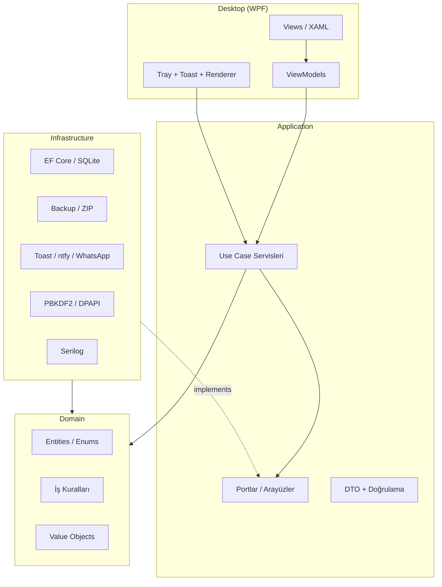
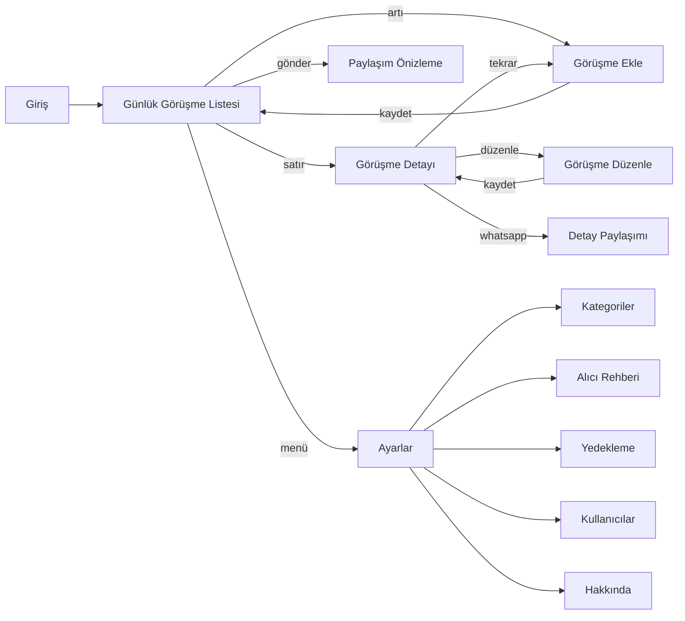
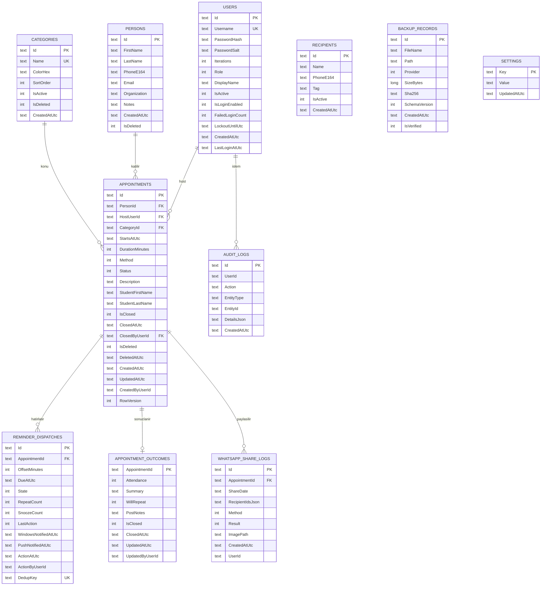
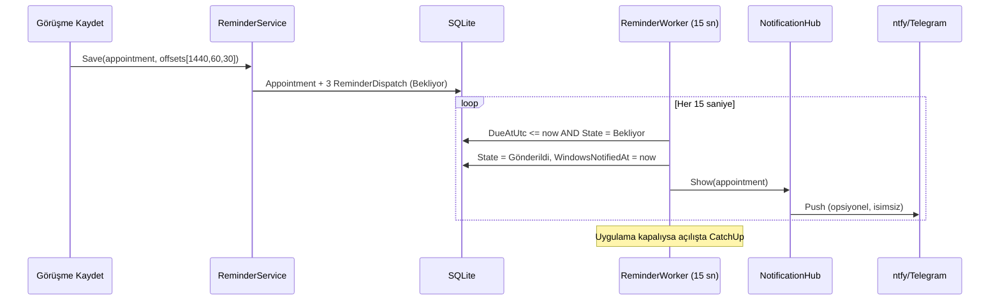
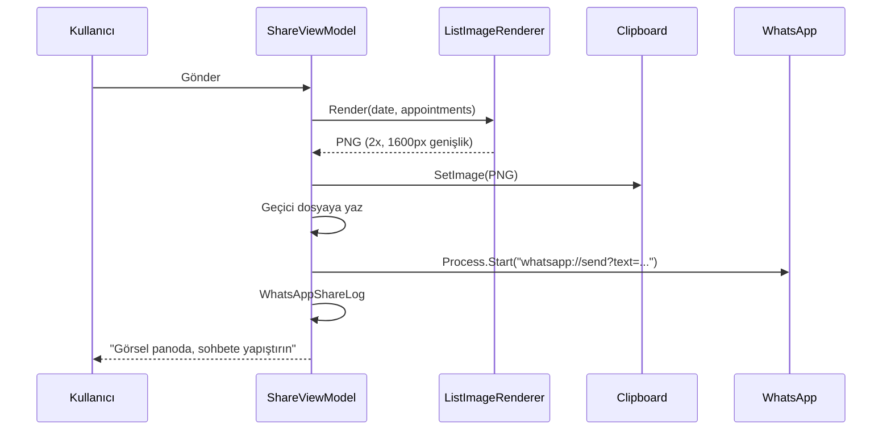

# 03 — Mimari ve Veri Modeli

**Sürüm:** 0.2 · **Tarih:** 07.11.2026
**İlgili:** [Gereksinimler](02_Gereksinimler.md) · [Proje Planı](04_Proje_Plani_ve_Surec.md)

---

## 1. Mimari kararlar (özet)

| Karar | Seçim | Gerekçe |
|-------|-------|---------|
| UI | **WPF (.NET 8)** | Windows 11'de olgun, hızlı, tema ve yüksek DPI desteği iyi; tek geliştirici için öğrenme maliyeti düşük |
| Dil/runtime | C# 12 / .NET 8 | Bu makinede kurulu; LTS; self-contained yayın |
| Veri | **SQLite + EF Core 8** | Sunucusuz, tek dosya, WAL ile dayanıklı; yedeklemesi kolay |
| Mimari | **Katmanlı monolit (Domain / Application / Infrastructure / Desktop)** | Tek kullanıcı için mikroservis gereksiz; mobil için çekirdek yeniden kullanılabilir |
| MVVM | CommunityToolkit.Mvvm | Kaynak üreteçli, az kod, test edilebilir ViewModel |
| DI/Host | Microsoft.Extensions.Hosting | Yapılandırma, yaşam döngüsü, arka plan worker |
| Log | Serilog (rolling file) | PII redaksiyonu, teşhis |
| Bildirim | Windows toast + özel WPF penceresi + ntfy/Telegram | 4 aksiyon toast'ta gösterilemez; pencere gerekir |
| WhatsApp | Yarı otomatik (PNG + pano + deep link) | Ban riski yok, MVP için yeterli |
| Yedek | ZIP + manifest + SHA-256; SQLite online backup | Tutarlı kopya, doğrulanabilir |
| Paketleme | Inno Setup, per-user | Yönetici hakkı gerektirmez |

### 1.1 Neden WPF, MAUI değil?

MAUI Windows'ta hâlâ WinUI 3/WebView tabanlı karmaşık bir yığın ve masaüstü
deneyimi WPF kadar olgun değil. Hedef **şimdilik yalnızca Windows**. Mobil ihtiyacı
doğduğunda **Domain + Application** katmanları .NET Standard uyumlu kalacağı için
MAUI istemcisi aynı iş kurallarını kullanabilir. Arayüz kodu paylaşılmaz; bu bilinçli
bir tercihtir (UI başına maliyet, iş kurallarında tek doğruluk).

---

## 2. Katmanlar ve bağımlılık kuralı



**Kural:** Domain hiçbir katmana bağımlı değildir. Application yalnızca Domain'e
bağımlıdır. Infrastructure, Application'ın arayüzlerini uygular. Desktop, Application
ve Infrastructure'ı DI ile birleştirir.

### 2.1 Çözüm yapısı

```
CgpRandevuTakip.sln
src/
  CgpRandevuTakip.Domain/           # net8.0
    Entities/                    # Appointment, Person, Category, User, ...
    Enums/                       # AppointmentStatus, ReminderOffset, ...
    ValueObjects/                # PhoneNumber, DateRange
    Rules/                       # ReminderScheduleCalculator, BackupFileNameBuilder
    Common/                      # EntityBase, Result
  CgpRandevuTakip.Application/      # net8.0
    Abstractions/                # IAppDbContext, IClock, ICurrentUser, IHasher, ...
    Services/                    # AppointmentService, AuthService, ReminderService, ...
    Dtos/                        # AppointmentListItem, AppointmentDetail, ...
    Validation/                  # FluentValidation kuralları
  CgpRandevuTakip.Infrastructure/   # net8.0
    Persistence/                 # AppDbContext, Configurations, Migrations
    Security/                    # Pbkdf2PasswordHasher, DpapiSecretStore
    Backup/                      # ZipBackupService, SqliteSnapshot
    Notifications/               # NtfyNotifier, TelegramNotifier, ToastAdapter
    Sharing/                     # WhatsAppLauncher, ShareLog
    Time/                        # SystemClock
  CgpRandevuTakip.Desktop/          # net8.0-windows, WPF
    App.xaml / App.xaml.cs       # Host, DI, tek örnek, tray
    Views/                       # Login, DayList, AppointmentForm, Details, Settings, ...
    ViewModels/
    Controls/                    # FloatingActionButton, CategoryBadge, ReminderChip
    Services/                    # NavigationService, DialogService, ImageRenderer
    Themes/                      # Dark.xaml, Light.xaml, Auto
    Resources/                   # tr-TR.resx, ikonlar
  CgpRandevuTakip.Tests/            # xUnit + FluentAssertions
    Unit/ Integration/ Ui/
installer/
  CgpRandevuTakip.iss               # Inno Setup
docs/
```

### 2.2 Katmanların sorumlulukları

| Katman | Yapar | Yapmaz |
|--------|-------|--------|
| Domain | Entity, enum, hesaplama, değişmezler | Veritabanı, dosya, UI, HTTP |
| Application | Use case akışı, yetki, doğrulama, transaction sınırı | SQL, XAML, Win32 |
| Infrastructure | EF Core, dosya, ağ, şifreleme, bildirim | İş kararı |
| Desktop | Görünüm, kullanıcı etkileşimi, navigasyon | Doğrudan SQL |

---

## 3. Ekran haritası ve navigasyon



- Navigasyon `INavigationService` ile yapılır; ViewModel doğrudan pencere açmaz.
- Modal akışlar (ekle/düzenle) ayrı pencere; liste durumu korunur.
- Geri tuşu/`Esc` kaydedilmemiş değişiklik varsa onay ister.

---

## 4. Veri modeli

### 4.1 ERD



> `Student` MVP'de görüşme üzerinde iki metin alanıdır. Faz 2'de ayrı `Students`
> tablosuna taşınabilir; bu, veri kaybı olmadan migration ile yapılır.

### 4.2 Alan kuralları ve türler

| Tablo | Alan | Kural |
|-------|------|-------|
| Users | Username | 3-32, benzersiz, harf/rakam/`.`/`_` |
| Users | Role | 0=Admin, 1=Secretary, 2=Host |
| Users | PasswordHash/Salt | Base64; PBKDF2-SHA256 32 byte |
| Persons | PhoneE164 | `^\+[1-9]\d{7,14}$`; TR için `+90` |
| Appointments | StartsAtUtc | ISO-8601 UTC (`2026-11-06T11:30:00Z`) |
| Appointments | DurationMinutes | 5-240, varsayılan 30 |
| Appointments | Method | 0=Telefon, 1=YüzYüze, 2=WhatsApp, 3=İnternet |
| Appointments | Status | 0=Planlandı, 1=Geldi, 2=Gelmedi, 3=Ertelendi, 4=İptal, 5=Tamamlandı |
| Outcomes | Attendance | 0=Geldi, 1=Gelmedi, 2=Ertelendi, 3=İptal |
| Reminders | OffsetMinutes | 1440, 60, 30 (başka değer reddedilir) |
| Reminders | State | 0=Bekliyor, 1=Gönderildi, 2=SadeceKapatıldı, 3=BilgiVerildi, 4=Ertelendi, 5=İptal, 6=Kaçırıldı, 7=Yanıtsız |
| Reminders | DedupKey | `{appointmentId}:{offset}:{generation}` benzersiz |
| Settings | Key | 100 karakter, benzersiz |

### 4.3 İndeksler

```sql
CREATE UNIQUE INDEX UX_Users_Username ON Users(Username);
CREATE UNIQUE INDEX UX_Categories_Name ON Categories(Name COLLATE NOCASE) WHERE IsDeleted = 0;
CREATE INDEX IX_Persons_Phone ON Persons(PhoneE164);
CREATE INDEX IX_Persons_Name ON Persons(LastName, FirstName);
CREATE INDEX IX_Appointments_Start ON Appointments(StartsAtUtc) WHERE IsDeleted = 0;
CREATE INDEX IX_Appointments_Person ON Appointments(PersonId);
CREATE INDEX IX_Appointments_HostStart ON Appointments(HostUserId, StartsAtUtc);
CREATE INDEX IX_Reminders_Due ON ReminderDispatches(State, DueAtUtc);
CREATE UNIQUE INDEX UX_Reminders_Dedup ON ReminderDispatches(DedupKey);
CREATE INDEX IX_Audit_Created ON AuditLogs(CreatedAtUtc DESC);
```

### 4.4 Saklama politikası

- Tüm tarihler **UTC** saklanır, kullanıcıya `Europe/Istanbul` ile gösterilir.
- `IsDeleted` soft delete; 30 gün sonra arka plan işi kalıcı siler (ayar).
- `AuditLogs` 2 yıl; sonra arşiv/anonimleştirme.
- Veritabanı: `%LocalAppData%\CgpRandevuTakip\data.db`
- Ekler (Faz 2): `...\attachments\{appointmentId}\`

---

## 5. Anahtar akışlar

### 5.1 Hatırlatıcı üretimi ve gönderimi



**Algoritma (sözde kod):**

```
now = clock.UtcNow
due = db.Reminders
        .Where(r => r.State == Pending && r.DueAtUtc <= now
                    && !r.Appointment.IsDeleted
                    && r.Appointment.Status == Scheduled)
        .OrderBy(r => r.DueAtUtc)
foreach r in due:
    if now - r.DueAtUtc > 12h and r.Appointment.StartsAtUtc < now:
        r.State = Missed; continue
    if r.WindowsNotifiedAt == null:
        notificationHub.Show(r)          // UI thread
        r.WindowsNotifiedAt = now
        if r.PushNotifiedAt == null: push.Send(r)   // best effort, retry 3
    r.State = Sent
```

- Worker `PeriodicTimer(15 sn)`; UI dışı thread'den pencere açmak için
  `Application.Current.Dispatcher.InvokeAsync`.
- Gönderim idempotent: `WindowsNotifiedAt` doluysa tekrar gösterilmez.
- Uygulama kapalıyken due olanlar açılışta `CatchUpService` tarafından işlenir.

### 5.2 Günlük liste PNG üretimi ve paylaşım



**Teknik notlar:**

- `RenderTargetBitmap` ile **ekranda görünmeyen** bir `UserControl` render edilir.
  `PrintScreen` kullanılmaz; böylece başka pencereler ve PII sızıntısı olmaz.
- Görsel genişliği 1600 px, DPI 192 (2x); WhatsApp'ta okunaklı kalır.
- Metin şablonu:
  ```
  {kurum} — {tarih} Görüşme Listesi ({adet} kişi)
  1) 09:00 · Ahmet Yılmaz · Dr. Ayşe K. · Danışmanlık
  ...
  ```
- `whatsapp://send?text=` URL-encode edilir. Telefon biliniyorsa
  `https://wa.me/905...?text=` ile doğrudan sohbet açılır.
- Çoklu alıcı: WhatsApp Desktop'ta "Yeni sohbet → kişileri seç" adımı kullanıcıya
  gösterilir; uygulama otomatik çoklu gönderim yapmaz.

### 5.3 Günlük otomatik paylaşım tetiklemesi

```
her dakika:
  if settings.DailyShareEnabled
     and now.LocalTime >= settings.DailyShareTime
     and lastShareDate < today
     and appointments(today).Any():
        open ShareWindow (kullanıcı onayı)
        lastShareDate = today   // pencere açıldığında işaretlenir
```

- Bilgisayar kapalıysa `lastShareDate < today` koşulu açılışta yakalanır ve
  "Bugünün listesi henüz paylaşılmadı" uyarısı gösterilir.
- **Otomatik gönderim yoktur**; yalnızca hazırlık penceresi açılır (FR-SHR-13).

### 5.4 Yedekleme

```
1. SQLite online backup → %TEMP%\gt_snapshot.db
2. manifest.json üret:
   { appVersion, schemaVersion, createdAtUtc, counts:{...},
     sha256: hash(snapshot), fileName }
3. ZIP: snapshot.db + manifest.json (+ attachments/)
4. Geçici .tmp dosyaya yaz → File.Move(tmp, final)  // atomik
5. ZIP'i aç, manifest + hash doğrula
6. BackupRecord ekle, son 30 kaydı tut
```

**Geri yükleme:**

```
1. ZIP aç, manifest oku, şema sürümünü kontrol et
2. Hash doğrula (bozuksa reddet, mevcut veri dokunulmaz)
3. Mevcut DB'yi otomatik yedekle (restore-öncesi)
4. Bağlantıları kapat, snapshot'ı canlı DB'ye SQLite backup API ile yaz
5. Migration çalıştır (eski şema → yeni)
6. Uygulamayı yeniden başlat, kayıt sayılarını karşılaştır
```

- Yedek adı: `CGP_RandevuTakip_Yedek_2026-11-06_14-30-00.zip`.
- Google Drive adaptörü (`IBackupProvider`) Faz 2'de eklenir; çekirdek akış değişmez.

### 5.5 Windows bildirimi ve 4 aksiyon

- Toast: `Microsoft.Toolkit.Uwp.Notifications` (unpackaged için AUMID + kısayol).
  Toast'ta yalnızca "Randevu yaklaşıyor · 14:30" + "Aç" butonu.
- "Aç" → uygulama içi **Hatırlatma Penceresi** (topmost, görev çubuğu yanıp söner):
  - Ad soyad, saat, host, kategori, telefon
  - 4 buton: `Bildirimi kapat` · `Bilgi verildi` · `Ulaşılamadı (+10 dk)` · `İptal etti`
  - Sayaç: "30 dk sonra" bilgisi
- Pencere kapatılırsa aksiyon alınmamış sayılır; 10 dk sonra tekrar (max 3).
- Kilit ekranında toast içeriği gizlenir (kişisel veri).

### 5.6 Push (ntfy) akışı

```
POST https://ntfy.sh/{topic}
Title: "Randevu hatırlatması"
Priority: high
Body: "14:30 — Randevu yaklaşıyor"   // isim varsayılan kapalı
```

- Topic ayarlarda üretilir (20 karakter rastgele), DPAPI ile saklanır.
- Hata durumunda 3 deneme (1, 5, 15 sn); başarısızsa uygulama içi uyarı.
- Telegram alternatifi: bot token + chat id; aynı `IPushNotifier` arayüzü.

---

## 6. Güvenlik mimarisi

| Konu | Uygulama |
|------|----------|
| Şifre | PBKDF2-SHA256, 210.000 iterasyon, 16 byte salt, 32 byte hash; sabit zamanlı karşılaştırma |
| Yetki | `ICurrentUser` + servis içi kontrol; UI yalnızca görünürlük |
| Oturum | Bellekte; kapanışta temizlenir; 30 dk hareketsizlikte kilit |
| Sırlar | DPAPI (`ProtectedData`, CurrentUser) — ntfy topic, Telegram token, Drive refresh token |
| DB | NTFS kullanıcı izinleri; Faz 2 SQLCipher opsiyonu |
| Yedek | Faz 1 düz ZIP + SHA-256; Faz 2 AES-256-GCM (parola) |
| Log | Serilog; ad/telefon/açıklama redakte; korelasyon kimliği |
| Denetim | Append-only tablo; UPDATE/DELETE engelleyen trigger |
| Girdi | Tüm DTO'lar FluentValidation; EF parametreli sorgu |
| Dış bağlantı | Yalnızca HTTPS; sertifika doğrulama varsayılan |
| Güncelleme | MVP manuel; paket imzası için hazırlık |

> **Tehdit modeli (özet):** Yerel dosya erişimi olan biri veritabanını okuyabilir.
> Tek kullanıcılı masaüstünde tam koruma için disk şifreleme (BitLocker) önerilir.
> Uygulama bunu zorlayamaz; KVKK dokümanında belirtilir.

---

## 7. Hata yönetimi ve gözlemlenebilirlik

- Global `DispatcherUnhandledException` + `AppDomain.UnhandledException` +
  `TaskScheduler.UnobservedTaskException` yakalanır.
- Kullanıcıya: "Beklenmeyen bir hata oluştu. Günlük dosyası: …" + "Kopyala".
- Günlük: `%LocalAppData%\CgpRandevuTakip\logs\app-YYYYMMDD.log`, 7 gün.
- Kritik işlemler (yedek, geri yükleme, migration) ayrı `audit` ve `operations` logu.
- Sağlık göstergesi: Ayarlar → Hakkında altında "Son yedek", "Son hata", "DB sürümü".

---

## 8. Dağıtım ve işletim

| Konu | Karar |
|------|-------|
| Yayın | `dotnet publish -c Release -r win-x64 --self-contained true` |
| Kurulum | Inno Setup, per-user, `%LocalAppData%\Programs\CgpRandevuTakip` |
| Kısayol | Başlat menüsü + masaüstü (opsiyonel) |
| Otomatik başlangıç | HKCU `Run` anahtarı, kurulumda onay |
| Tek örnek | `Mutex("Global\\CgpRandevuTakip")`; ikinci çağrı mevcut pencereyi öne getirir |
| Veri | `%LocalAppData%\CgpRandevuTakip` |
| Yedek | Varsayılan `Belgeler\CgpRandevuTakip\Yedekler` |
| Kaldırma | Veri klasörü korunur; "verileri de sil" onayı |
| Sürüm | SemVer (`1.0.0`), Assembly + Hakkında ekranı |
| Geri alma | Önceki sürüm kurulumu + restore-öncesi yedek |

---

## 9. Test edilebilirlik

- `IClock` ile zaman test edilebilir (hatırlatıcı hesapları).
- `IAppDbContext` arayüzü sayesinde SQLite in-memory / geçici dosya ile entegrasyon testi.
- `IImageRenderer`, `IWhatsAppLauncher`, `IPushNotifier` arayüzleri mock'lanır.
- Domain kural testleri UI'sız çalışır.
- UI smoke: FlaUI (Faz 2) veya elle senaryo listesi.

---

## 10. ADR özeti

| ID | Karar | Alternatifler | Sonuç |
|----|-------|---------------|-------|
| ADR-01 | WPF | WinUI 3, Avalonia, Electron | Windows odaklı en düşük risk |
| ADR-02 | SQLite + EF Core | LiteDB, JSON, SQL Server | Güvenilir, sorgulanabilir, yedeklenebilir |
| ADR-03 | Yarı otomatik WhatsApp | Cloud API, whatsapp-web.js | Ban/maliyet riski yok |
| ADR-04 | Yerel kullanıcı/rol | Windows kimliği, sunucu | Tek PC, basit |
| ADR-05 | Katmanlı monolit | Mikroservis | Tek geliştirici, düşük operasyon |
| ADR-06 | DB tabanlı hatırlatıcı | Zamanlayıcı servis, cron | Yeniden başlatmaya dayanıklı |
| ADR-07 | RenderTargetBitmap | PrintScreen, ekran yakalama | Temiz, test edilebilir görsel |
| ADR-08 | ZIP + manifest | Tek DB kopyası, özel format | Doğrulanabilir, taşınabilir |
| ADR-09 | ntfy varsayılan push | Telegram, e-posta | Kurulumu en kolay, ücretsiz |
| ADR-10 | Türkçe-only + resx | Çok dilli | Kapsamı dar tutar, ileride genişler |

---

## 11. Gelecekte mobil

- `Domain` ve `Application` `net8.0` hedefli kalır; MAUI (`net8.0-android/ios`)
  bunları doğrudan referanslar.
- Platforma özel olanlar arayüz arkasında: bildirim, dosya, pano, WhatsApp açma.
- Senkronizasyon Faz 3: yerel SQLite + değişiklik günlüğü (change log) ve çakışma
  çözümü. Şimdiden `RowVersion` ve `UpdatedAtUtc` alanları bunu destekler.
- Mobilde otomatik WhatsApp gönderimi yine yapılmaz; resmî API değerlendirilir.
