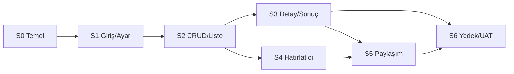

# 04 — Proje Planı, Süreç ve Test Stratejisi

**Sürüm:** 0.2 · **Tarih:** 07.11.2026
**İlgili:** [Gereksinimler](02_Gereksinimler.md) · [Mimari](03_Mimari_ve_Veri_Modeli.md)

---

## 1. Süreç modeli

**Yaklaşım:** İteratif-artırmalı (Agile/Scrum-lite) + faz kapıları.
Tek geliştirici olduğu için ağır Scrum törenleri değil, **kısa döngüler ve
çalışan yazılım** esastır. Her sprint kendi içinde mini bir SDLC döngüsü çalıştırır:

```
Planla → Tasarımla → Gerçekleştir → Test et → Gözden geçir → İyileştir
   ↑                                                              │
   └──────────────── geri bildirim / backlog ─────────────────────┘
```

### 1.1 Fazlar ve kapılar

| Faz | Çıktı | Kapı kriteri |
|-----|-------|--------------|
| **Keşif (Discovery)** | Vizyon, gap analizi, gereksinimler | Ürün sahibi onayı, açık soruların kapatılması |
| **Başlangıç (Inception)** | Mimari, veri modeli, risk planı, prototip | Teknik spike'lar başarılı, ADR'ler onaylı |
| **Detaylandırma (Elaboration)** | Sprint 1-2, çalışan iskelet | Giriş + CRUD + liste çalışıyor |
| **İnşa (Construction)** | Sprint 3-6, tüm MVP | Tüm P0/P1 kabul kriterleri geçiyor |
| **Geçiş (Transition)** | Kurulum paketi, UAT, eğitim | UAT onayı, yedek/geri yükleme kanıtı |
| **İşletim (Operation)** | Destek, hata düzeltme, Faz 2 | Aylık gözden geçirme |

> Faz kapıları **döngüseldir**: UAT'ta çıkan bir sorun Construction'a geri döner;
> yeni gereksinim Keşif'e geri beslenir. Kapı, "her şey bitti" demek değil,
> "bir sonraki faza geçmek için yeterli güven var" demektir.

### 1.2 Törenler (minimum)

| Tören | Sıklık | Süre | Çıktı |
|-------|--------|------|-------|
| Sprint planlama | 2 haftada bir | 60 dk | Sprint hedefi, seçilen maddeler |
| Günlük kontrol | Günlük | 5 dk | Engeller |
| Backlog iyileştirme | Haftada bir | 30 dk | Kabul kriterleri netleşmiş maddeler |
| Sprint incelemesi | 2 haftada bir | 30 dk | Çalışan demo, geri bildirim |
| Retrospektif | 2 haftada bir | 30 dk | 2 iyi, 2 iyileştirme, 1 aksiyon |
| Sürüm gözden geçirme | Sürüm öncesi | 60 dk | Go/No-Go |

---

## 2. Sprint planı

Toplam: **1 hafta Sprint 0 + 6 × 2 hafta = 13 hafta** (tek geliştirici, tam zaman).
Yarı zamanlı çalışmada 18-22 hafta öngörülür. Efor: ~95-115 adam-gün.

| Sprint | Süre | Hedef | Ana çıktılar | SP | Durum |
|--------|------|-------|--------------|----|-------|
| **0** | 1 hafta | Teknik temel ve risk doğrulama | Solution, CI, DB şeması, spike S-01…S-05, UI iskeleti | 13 | Tamamlandı (0.1.0) |
| **1** | 2 hafta | Güvenli giriş ve yapılandırma | Giriş, roller, tema, ayarlar kabuğu, kategori CRUD | 18 | Tamamlandı (0.2.0) |
| **2** | 2 hafta | Çekirdek kayıt ve günlük liste | Görüşme ekleme, günlük liste, tarih gezinme, arama | 21 | Tamamlandı (0.3.0) |
| **3** | 2 hafta | Kaydın yaşam döngüsü | Detay, düzenleme, sonuç, durum geçişleri, sıradaki kişi, kullanıcı yönetimi, oturum kilidi | 18 | Tamamlandı (0.4.0) |
| **3.5** | 1 gün | Stabilizasyon ve kapanış | CRUD doğrulama, silinenleri geri alma, 30 gün temizliği, host filtresi | 5 | Tamamlandı (0.4.1) |
| **4** | 2 hafta | Hatırlatma vaadi | Reminder motoru, toast, aksiyon penceresi, push, telafi, tepsi, sessiz saatler | 21 | Tamamlandı (0.5.0) |
| **4.5** | 1-2 gün | UAT ve kapanış | Gerçek toast/push/tray/auto-start doğrulaması | 5 | Tamamlandı (0.5.3) |
| **4.6** | 1 gün | Kimlik ve kurtarma | Beni hatırla, e-posta ile şifre sıfırlama | 8 | Tamamlandı (0.5.4) |
| **5** | 2 hafta | Günlük paylaşım | PNG render, pano, WhatsApp deep link, alıcı rehberi, zamanlayıcı | 21 | Tamamlandı (0.6.0) |
| **6** | 2 hafta | Veri güvenliği ve sürüm | Yedek/geri yükleme, denetim, kurulum, UAT, hata düzeltme | 21 | Planlandı |

**Toplam:** ~138 SP (Sprint 3.5 dahil). Hız (velocity) ilk sprintte ölçülür; 18-22 SP/sprint
varsayımı gerçekleşmezse kapsam değil **tarih** esnetilir (MVP sabit tutulur).

> **Güncel durum (10.11.2026):** Sprint 0-5, 4.5 UAT, 4.6 kimlik/kurtarma ve manuel düzeltmeler tamamlandı, sürüm **0.6.2**,
> **179/179 test** geçiyor, derleme 0 uyarı / 0 hata. Sprint 5 sonuçları için
> [docs/16_Sprint5_Raporu.md](16_Sprint5_Raporu.md).

### 2.1 Sprint 0 — ayrıntılı

| İş | Çıktı | Süre |
|----|-------|------|
| Solution + proje iskeleti | Derlenen boş uygulama | 0,5 gün |
| EF Core + ilk migration | `data.db` oluşuyor | 1 gün |
| DI/Host/tray/tek örnek | Tepside çalışan uygulama | 0,5 gün |
| Spike S-01: WhatsApp'a pano görseli yapıştırma | Sonuç raporu | 0,5 gün |
| Spike S-02: Toast + kilit ekranı | Sonuç raporu | 0,5 gün |
| Spike S-03: ntfy push | Sonuç raporu | 0,5 gün |
| Spike S-04: SQLite online backup | Sonuç raporu | 0,5 gün |
| Spike S-05: 1000 kayıt listesi | Ölçüm | 0,5 gün |
| CI (build + test) | Yeşil pipeline | 0,5 gün |
| UI tasarım sistemi (renk, tipografi, buton) | Tema dosyaları | 1 gün |

### 2.2 Sprint bağımlılıkları



- S4 ve S5 kısmen paralel yürüyebilir (farklı modüller).
- S6'ya giriş için S2-S5'in "çalışan" olması gerekir; kusursuz olması gerekmez.

---

## 3. Ürün backlog'u (MVP)

| ID | Hikâye | Öncelik | SP | Sprint |
|----|--------|---------|----|--------|
| PB-01 | Çözüm iskeleti, DB, CI | Must | 8 | 0 |
| PB-02 | Teknik spike'lar | Must | 5 | 0 |
| PB-03 | Giriş + roller + oturum | Must | 8 | 1 |
| PB-04 | Tema + navigasyon kabuğu | Must | 5 | 1 |
| PB-05 | Kategori CRUD | Must | 5 | 1 |
| PB-06 | Görüşme ekleme + doğrulama | Must | 8 | 2 |
| PB-07 | Günlük liste + tarih gezinme | Must | 8 | 2 |
| PB-08 | Arama + filtre | Should | 5 | 2 |
| PB-09 | Görüşme detayı | Must | 5 | 3 |
| PB-10 | Görüşme düzenleme | Must | 5 | 3 |
| PB-11 | Sonuç + durum geçişleri | Must | 8 | 3 |
| PB-12 | Hatırlatıcı motoru | Must | 8 | 4 |
| PB-13 | Toast + aksiyon penceresi (4 seçenek) | Must | 8 | 4 |
| PB-14 | Push (ntfy/Telegram) | Should | 5 | 4 |
| PB-15 | PNG render + pano + WhatsApp | Must | 8 | 5 |
| PB-16 | Alıcı rehberi + günlük tetikleme | Should | 8 | 5 |
| PB-17 | Yedekleme + geri yükleme | Must | 8 | 6 |
| PB-18 | Denetim kaydı | Should | 5 | 6 |
| PB-19 | Kurulum paketi + UAT | Must | 8 | 6 |

**Tanımsız kalan (Faz 2):** Google Drive, raporlar, Excel, tekrar serisi, yedek
şifreleme, PDF, toplu işlem, otomatik güncelleme.

---

## 4. Hazırlık ve tamamlanma tanımları

### 4.1 Definition of Ready (DoR)

Bir madde sprint'e alınmadan önce:

- [ ] Kullanıcı hikâyesi ve en az 2 kabul kriteri yazılı
- [ ] Ekran/akış taslağı veya wireframe var
- [ ] Veri etkisi (yeni alan/tablo) belirlenmiş
- [ ] Bağımlılıklar ve riskler not edilmiş
- [ ] 1 sprint içinde bitirilebilir büyüklükte (≤ 8 SP)
- [ ] Test yaklaşımı belli

### 4.2 Definition of Done (DoD)

- [ ] Kod derleniyor, uyarı yok (veya gerekçeli bastırılmış)
- [ ] Birim testleri yazıldı ve geçiyor
- [ ] Kabul kriterleri elle/otomatik doğrulandı
- [ ] Hata ve boş durumlar ele alındı
- [ ] PII loglanmıyor
- [ ] Tema (koyu/açık) ve %150 DPI kontrol edildi
- [ ] Doküman/ADR güncellendi
- [ ] Sürüm notuna madde eklendi
- [ ] Demo yapıldı

---

## 5. Tahmin ve kapasite

| Kalem | Değer |
|-------|-------|
| Haftalık net kapasite (tam zaman) | 5 gün × 5 saat odak = 25 saat |
| Sprint kapasitesi | ~50 saat |
| 1 SP (referans) | ~4 saat |
| Tampon | %20 (hata, destek, sürpriz) |
| MVP toplam | ~138 SP ≈ 550 saat ≈ 13 hafta + 1 gün |
| Yarı zamanlı (20 saat/hafta) | ~27 hafta |

> Tahminler **kaba büyüklük** (T-shirt + SP) düzeyindedir. İlk 2 sprintin gerçek
> hızı ölçülmeden kesin tarih verilmez. Bu, klasik "tahmin yanılgısı"nı önler.

---

## 6. Test stratejisi

### 6.1 Test seviyeleri

| Seviye | Kapsam | Araç | Sıklık |
|--------|--------|------|--------|
| Birim | Domain kuralları, hesaplamalar, doğrulama | xUnit + FluentAssertions | Her commit |
| Entegrasyon | EF Core, SQLite, yedek/restore, migration | xUnit + geçici DB | Her PR |
| Servis | Use case + yetki + transaction | xUnit + mock | Her PR |
| UI smoke | Kritik akışlar | Elle senaryo / FlaUI (Faz 2) | Her sprint |
| Keşifsel | Senaryo dışı kullanım | Elle | Sprint sonu |
| Performans | Açılış, liste, PNG, yedek | Benchmark + kronometre | Sürüm öncesi |
| Dayanıklılık | 24 saat açık, uyku/uyanma, saat değişimi | Elle/otomasyon | Sürüm öncesi |
| Güvenlik | Yetki atlatma, log PII, zayıf şifre | Kontrol listesi | Sürüm öncesi |
| UAT | Gerçek kullanıcı senaryoları | Elle | S6 sonu |

### 6.2 Kritik test senaryoları

| TC | Senaryo | Beklenen | İlgili |
|----|---------|----------|--------|
| TC-01 | Doğru giriş | Ana ekran açılır | FR-AUTH-01 |
| TC-02 | 5 hatalı giriş | Hesap 15 dk kilit | FR-AUTH-04 |
| TC-03 | Görüşmeci başka kaydı açmaya çalışır | Yetki hatası / görünmez | BR-20 |
| TC-04 | Zorunlu alan boş kayıt | Kayıt engellenir, alan işaretlenir | FR-APPT-02 |
| TC-05 | Geçersiz telefon | Kayıt engellenir | FR-APPT-03 |
| TC-06 | 3 hatırlatıcı seçimi | 3 `Bekliyor` kaydı | FR-REM-02 |
| TC-07 | Geçmiş saatli hatırlatıcı | Planlanmaz, kullanıcı bilgilendirilir | BR-05 |
| TC-08 | Randevu 30 dk önce | Toast + pencere | FR-REM-03 |
| TC-09 | "Bildirimi kapat" | Log `DismissedOnly`, randevu değişmez | FR-REM-05 |
| TC-10 | "Ulaşılamadı" | 10 dk sonra yeni bildirim | FR-REM-07 |
| TC-11 | "İptal etti" | Durum `İptal`, kalan hatırlatıcılar iptal | FR-REM-08 |
| TC-12 | Uygulama kapalıyken hatırlatma | Açılışta gecikmiş gösterim | FR-REM-10 |
| TC-13 | Aynı hatırlatıcı iki kez | Tek gösterim | FR-REM-12 |
| TC-14 | Tarih değiştir + kaydet | Eski hatırlatıcılar iptal, yenileri oluşur | FR-APPT-10 |
| TC-15 | Günlük liste PNG | Buton yok, 2x, doğru satırlar | FR-SHR-01/02 |
| TC-16 | WhatsApp yok | WhatsApp Web açılır | FR-SHR-12 |
| TC-17 | Yedek al | ZIP + manifest + hash doğru | FR-BKP-02/03 |
| TC-18 | Bozuk ZIP geri yükle | Reddedilir, veri bozulmaz | FR-BKP-09 |
| TC-19 | Geçerli yedek geri yükle | Kayıtlar birebir gelir | FR-BKP-06/08 |
| TC-20 | Kullanımdaki kategoriyi sil | Engellenir, pasifleştirme önerilir | FR-CAT-03 |
| TC-21 | 1000 kayıt liste | < 300 ms | NFR-PERF-02 |
| TC-22 | %200 DPI | Taşma/kırpılma yok | NFR-USE-06 |
| TC-23 | Sistem saati ileri al | Hatırlatıcılar tutarlı | BR-22 |
| TC-24 | 24 saat açık | Bellek < 250 MB, çökme yok | NFR-REL-05 |
| TC-25 | Log incelemesi | Telefon/ad/açıklama yok | NFR-SEC-03 |

### 6.3 Test verisi

- 20 kişi, 6 kategori, 3 host, 200 görüşme (geçmiş/gelecek/bugün).
- Sınır örnekleri: 23:59 randevusu, 00:00, aynı saatte 3 kayıt, çok uzun ad,
  Türkçe karakter (`İ, ı, ş, ğ, ü, ö, ç`), +90 dışı numara.
- Üretim verisiyle test yapılacaksa **anonimleştirilmiş** kopya kullanılır.

### 6.4 Hata önem dereceleri

| Seviye | Tanım | Tepki |
|--------|-------|-------|
| S1 / Kritik | Veri kaybı, giriş yapılamıyor, yedek bozuk | Aynı gün düzeltme, sürüm bloke |
| S2 / Yüksek | Hatırlatıcı çalışmıyor, paylaşım bozuk | 2 iş günü |
| S3 / Orta | Arayüz hatası, yavaşlık | Sprint içinde |
| S4 / Düşük | Kozmetik, metin | Backlog |

---

## 7. Sürüm ve geçiş planı

| Aşama | Kriter | Kullanıcı |
|-------|--------|-----------|
| **Alpha** (S4 sonu) | Çekirdek akış çalışıyor, yedek yok | Geliştirici |
| **Beta** (S5 sonu) | Paylaşım çalışıyor, veri modeli sabit | 1 pilot kullanıcı |
| **UAT** (S6) | Tüm P0/P1 kabul kriterleri | Sekreter + yönetici |
| **v1.0** | UAT onayı + 1 hafta pilot | Tüm kurum |
| **v1.1+** | Hata düzeltmeleri + Faz 2 | Tüm kurum |

**Go/No-Go kontrol listesi (v1.0):**
- [ ] Yedek al → sil → geri yükle senaryosu kanıtlandı
- [ ] 3 günlük gerçek veriyle hatırlatma doğruluğu ≥ %98
- [ ] Kurulum yönetici hakkı olmadan yapıldı
- [ ] Kaldırma/veri koruma testi yapıldı
- [ ] Kullanıcı eğitimi (30 dk) verildi
- [ ] Destek kanalı ve sürüm notu hazır

**Geri alma planı:** Yeni sürüm sorun çıkarırsa önceki kurulum + restore-öncesi
otomatik yedek geri yüklenir. Veritabanı şema sürümü ileri taşınmışsa eski
uygulama açılmaz; bu nedenle migration'lar geriye uyumlu tasarlanır veya
sürüm notunda "geri dönüş yok" uyarısı verilir.

---

## 8. Risk kaydı

| ID | Risk | Olasılık | Etki | Azaltma | Sahip |
|----|------|----------|------|---------|-------|
| R-01 | WhatsApp hesabının kısıtlanması | Düşük (yarı otomatik) | Yüksek | Resmî olmayan API kullanılmaması, kullanıcı onayı | Geliştirici |
| R-02 | Bildirimlerin kaçması (uygulama kapalı/uyku) | Orta | Yüksek | Tepside çalışma, açılışta telafi, push, otomatik başlangıç | Geliştirici |
| R-03 | Windows toast kısıtları (odak yardımı, kilit) | Orta | Orta | Uygulama içi topmost pencere + görev çubuğu uyarısı | Geliştirici |
| R-04 | Yedek bozulması / geri yükleme hatası | Düşük | Kritik | Hash, otomatik ön-yedek, test restore, atomik yazma | Geliştirici |
| R-05 | KVKK ihlali (PII sızıntısı) | Düşük | Kritik | Veri minimizasyonu, log redaksiyonu, erişim kontrolü, aydınlatma | Ürün sahibi |
| R-06 | Kapsam kayması | Yüksek | Orta | MoSCoW, sprint kapısı, değişiklik talebi | Ürün sahibi |
| R-07 | Tek geliştirici bağımlılığı | Orta | Yüksek | Dokümantasyon, testler, sürüm kontrolü | Sponsor |
| R-08 | Google Drive OAuth onay süreci | Orta | Düşük | Faz 2'ye erteleme, yerel yedek | Ürün sahibi |
| R-09 | Saat dilimi / sistem saati hataları | Düşük | Orta | UTC saklama, `IClock`, saat değişimi testi | Geliştirici |
| R-10 | ntfy/Telegram erişim engeli | Orta | Düşük | İki sağlayıcı, uygulama içi bildirim yedek | Geliştirici |
| R-11 | Yüksek DPI'da bozulma | Orta | Düşük | DPI testleri, esnek düzen | Geliştirici |
| R-12 | Kullanıcı direnci / alışkanlık | Orta | Yüksek | Basit akış, eğitim, pilot, geri bildirim | Ürün sahibi |
| R-13 | Veri hacmi büyümesi | Düşük | Orta | İndeksler, arşivleme, sanallaştırma | Geliştirici |
| R-14 | Kurumsal antivirüs/EDR engeli | Orta | Orta | İmzalı kurulum, istisna talebi, per-user kurulum | BT |

---

## 9. Değişiklik ve konfigürasyon yönetimi

- **Sürüm kontrolü:** Git; `main` korumalı, `feature/*` dalları, Conventional Commits.
- **Sürümleme:** SemVer; `CHANGELOG.md`.
- **Ortamlar:** Geliştirme (yerel) → Test (yerel DB kopyası) → Üretim (kurum PC'si).
- **Yapılandırma:** Ayarlar veritabanında; sırlar DPAPI. `.env` yok.
- **Yedekleme:** Her sürüm öncesi kaynak + veritabanı yedeği.
- **Değişiklik talebi:** CR formu, etki analizi, onay, backlog.
- **Kod incelemesi:** Tek geliştirici olsa da PR açılır, en az kendi kendine
  kontrol listesi uygulanır; kritik modüllerde ikinci göz (danışman) önerilir.

---

## 10. Metrikler

| Metrik | Hedef | Ölçüm |
|--------|-------|-------|
| Sprint hızı | Öngörülebilir (±%20) | Tamamlanan SP |
| Hata kaçış oranı | < 1 S1/S2 / sürüm | Sürüm sonrası hatalar |
| Hatırlatma doğruluğu | ≥ %98 | Log: due vs sent |
| Yedek başarı oranı | %100 | BackupRecord |
| Restore test başarısı | %100 | Aylık tatbikat |
| Çökme oranı | 0 / hafta | Günlükler |
| Kullanıcı memnuniyeti | ≥ 4/5 | Anket |
| Ortalama kayıt süresi | < 60 sn | Kullanıcı testi |

---

## 11. Roller (RACI)

| İş | Ürün Sahibi | Geliştirici | Pilot Kullanıcı | BT |
|----|:-----------:|:-----------:|:---------------:|:--:|
| Kapsam/öncelik | A/R | C | C | I |
| Tasarım | C | A/R | C | I |
| Geliştirme | I | A/R | I | I |
| Test/UAT | A | R | R | I |
| Kurulum | I | R | C | A |
| KVKK | A | C | I | C |
| Sürüm onayı | A/R | C | C | I |

---

## 12. İlk 10 iş günü (hemen başlanacaklar)

1. Ürün adı, yedek formatı ve "sırası gelen" kuralını onayla.
2. Solution iskeletini kur, `main` + CI.
3. SQLite şemasını ve ilk migration'ı yaz.
4. Tema token'larını ve ana pencere iskeletini oluştur.
5. Spike S-01 (WhatsApp pano) ve S-02 (toast) sonuçlarını raporla.
6. Giriş ekranı + PBKDF2 + rol altyapısı.
7. Kategori CRUD.
8. Görüşme entity + doğrulama + ekleme ekranı.
9. Günlük liste + tarih gezinme.
10. Sprint 0 retrospektifi ve Sprint 1 planı.

> Bu 10 madde tamamlandığında **çalışan, giriş yapılabilen ve kayıt tutan** bir
> uygulama olur; geri kalanı bu temelin üzerine inşa edilir.

